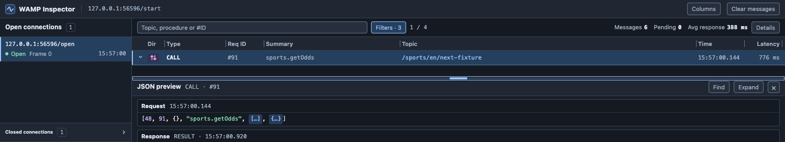

# WAMP Inspector

A Chrome DevTools extension for inspecting WAMP traffic over WebSocket. It shows connections, messages, request/response pairs, and their JSON payloads in a compact panel.



## Load in Chrome

1. Clone or download this repository and extract it if needed.
2. Open `chrome://extensions` and enable **Developer mode**.
3. Click **Load unpacked** and select the folder containing `manifest.json`.
4. Open a page that uses WAMP. Open Chrome DevTools and select **WAMP Inspector** from the tab bar or the `»` overflow menu.
5. Reload the inspected page to capture connections from the start.

The extension runs directly from the repository with no build step. After editing the source, reload the extension in `chrome://extensions`, refresh the inspected page, and reopen DevTools.

## Inspect traffic

- Select an open or closed connection to view its capture. The toolbar popup summarizes WAMP activity on the current tab.
- Search by topic, procedure, request ID, or any text in captured request and response payloads. Use `#ID` for an exact request ID and **Filters** to narrow by message type, response status, or latency.
- Select a message to inspect its payload. Use **Find** in JSON Preview to search keys and values within the selected Request and Response, including collapsed branches.
- Enable **Topic** from **Columns**, or click a key in JSON Preview to add that field as a custom column. Drag a column divider to resize it.
- Use **Clear messages** to clear the current tab’s message history and keep its connection list. The extension retains the latest 1,000 frames per recognized WAMP type per connection.

## Reuse a captured WAMP response

1. Select a captured `CALL` with a final server `RESULT` on an open `wamp.2.json` connection.
2. Click **Use as mock** in **JSON preview**. Edit the prefilled `RESULT` arguments in the same pane. **Find** searches the JSON while you edit.
3. Click **Enable mock** to use the saved response for every matching call. **Apply once** applies it to a single matching call. Matching uses the procedure and exact `kwargs.topic` across WAMP JSON connections in the source document. A call without a topic matches another call without one.

The editor accepts `[]`, `[args]`, or `[args, kwargs]`. **Mock response** in JSON preview shows the saved arguments alongside the captured **Response**. Reopen **Use as mock** on the source row to edit or apply the saved values again. The extension keeps those values in the connection's capture history, including after the one-shot rule is used.

The table shows **Mock armed** on the source row while the rule waits. When the server returns a final `RESULT` for the matching call, the extension substitutes the selected arguments in the browser and keeps the new request ID and server details. **Mocked** marks the row that used the substitute and its reply in JSON preview. Setting a mock sends no WAMP traffic. A server error or missing reply retains its usual behavior.

Above the table, **Mocks** lists the persistent rules for the tab. Enable, disable, or delete each rule independently. Saving a persistent rule updates the same procedure and topic. **Apply once** can override that rule for a single matching call. Rules and their enabled states are saved in `chrome.storage.session` across page refreshes and service worker restarts during the browser session. Persistent rules follow route changes made within the same page or iframe document.

The extension records the current page and iframe URLs, including routes changed after the socket opened. On a confirmed page reload, the first replacement iframe with the saved origin and path receives the rule, regardless of its position or query string. If a call finishes before the rule is restored, its actual reply is kept. A one-shot rule expires if it misses that call. An enabled persistent rule still applies to later matches. The status above the table shows the saved procedure and topic.

## Project layout

```text
manifest.json       Chrome extension entry points and permissions
icons/              Extension and DevTools icons
src/capture/        WebSocket hook, page bridge, and background storage
src/devtools/       DevTools panel, message filters, and JSON preview
src/popup/          Toolbar popup and current-tab summary
src/shared/         WAMP frame parsing and theme styles
tests/              Node tests for the extension
e2e/                Chrome end-to-end tests
docs/images/        Screenshots captured with local test traffic
```

## Run the tests

Run `npm test` from the repository root with Node.js 22 or newer. Install dependencies with `npm ci` first. The tests use Node’s built-in test runner.

Run `npm run typecheck` to check the capture worker, WAMP frame parser, and DevTools capture transport against the shared TypeScript contracts. The browser continues to run JavaScript from the repository directly.

Run `npm run format` to apply Prettier and `npm run format:check` to check formatting.

With Google Chrome installed, run `npm run test:e2e` to verify message search, one-shot mocking, and persistent mocks in DevTools with a local test fixture and a temporary browser profile.

## Bump the extension version

After **Bump Version** is on `main`, open **Actions → Bump Version → Run workflow** on `main` and choose `patch`, `minor`, or `major`. The workflow updates `manifest.json`, `package.json`, and `package-lock.json`, runs checks, and opens a version PR into `main`. For the first run, choose `patch` to move from `0.1.0` to `0.1.1`.

In **Settings → Actions → General**, enable **Allow GitHub Actions to create and approve pull requests** for the workflow to open the PR with its repository token.

## Package a release

Run `npm run build` to create `dist/wamp-inspector-<version>.zip` locally.

Run **Package WAMP Inspector** from the repository's **Actions** tab to download the extension ZIP as a workflow artifact. The workflow must be on the default branch before you can run it manually.

For a GitHub release, push a tag that matches the version in `manifest.json`, such as `v0.1.1`. After checks pass, the workflow attaches `wamp-inspector-<version>.zip` to a draft on the **Releases** page. Review the draft and publish it when ready.

The ZIP contains `manifest.json` at its root, along with the runtime files and icons. The same ZIP format is used for Chrome Web Store submissions.

## Data and permissions

The extension injects a WebSocket hook into supported pages and frames so it can observe WAMP traffic created by the page. It keeps captured traffic in memory in the extension’s service worker. Column preferences are stored locally and do not include payload contents.
